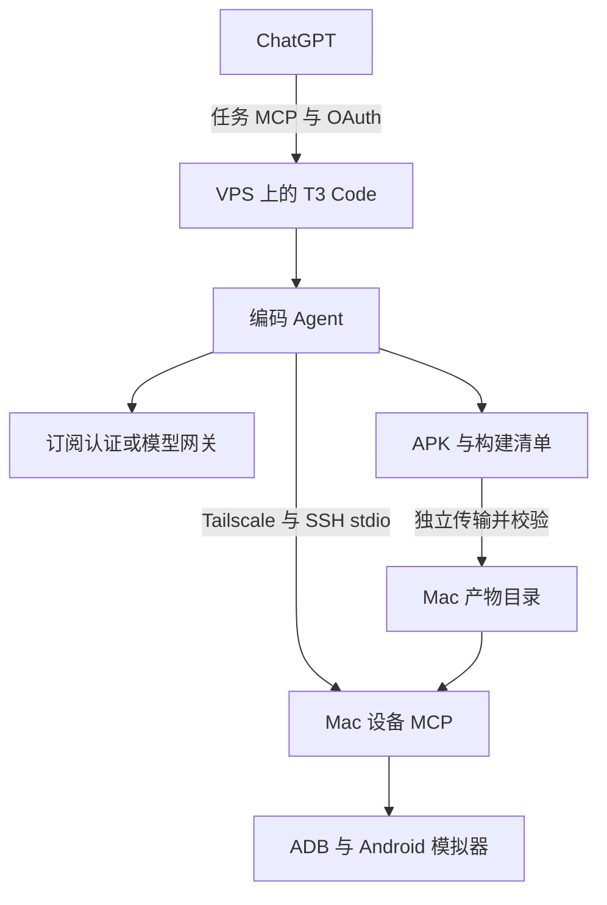

# 用 T3 Code 和 Mac 模拟器搭建云端 Agent 工作流的实践与排障

我想实现的工作方式很直接：在 ChatGPT 里讨论需求，把任务交给云端 Agent；Agent 修改代码并构建 Android 测试包，再调用 Mac 上的模拟器验证结果。

手边已经有一台安装 Docker 的 VPS、一台 Mac、Tailscale、Cloudflare、模型网关和 T3 Code。计算任务适合放到云端持续运行，模拟器则继续留在 Mac。为了这套规模引入 Kubernetes，没有必要；我选择从单机 Docker Compose 开始。

搭建过程中，真正花时间的是环境和权限之间的衔接。SSH 地址填对了，命令仍可能运行在另一台机器；MCP 能操作设备，也不意味着云端文件会自动出现在 Mac；终端里能调用模型，也不代表 T3 启动的 Provider 已经登录。

下面记录这套工作流的设计、实施过程和排障方法。服务器名称、地址、域名、用户名、仓库和应用标识均已替换为示例；代码里的占位符需要按实际环境填写。本文是一份阶段性实践记录，已确认的结果与后续验收放在文末分别说明。

## 1 先把任务调度和设备调试分开

我把系统拆成两条控制链路。

第一条是 **ChatGPT → T3 MCP → 云端 Agent**。它负责查看项目、读取任务、提交需求和跟进同一个任务。

第二条是 **云端 Agent → Mac MCP → ADB → Android 模拟器**。它负责设备发现、安装应用、启动、截图和界面操作。

模型网关提供模型访问，文件传输通道负责移动 APK。这几类能力分别配置，排障时才知道应该检查哪一层。



VPS 保存 T3 状态、Provider 配置、代码仓库、worktree、构建缓存和测试产物。Mac 保留 Android SDK、模拟器和设备控制程序。

网络入口也分工明确：Cloudflare 承接网页和任务 MCP 的外部入口，Tailscale 连接 VPS 与 Mac。网页交互登录和机器调用的 OAuth 各自验收，不能假设一个入口能登录，另一个入口就能正常调用。

## 2 先准备部署工程 再接真实环境

最初的交付包括运行时 Dockerfile、Compose、部署脚本、Mac 设备适配器和运维说明。部署使用独立项目与持久目录，保留 VPS 上已有的网关和其他服务。

运行时按固定发行版本和校验值构建，T3 与它启动的 Provider CLI 放在同一执行环境里。这让工作目录、子进程和凭据位置比较容易核对。编码容器采用专用用户，不挂载宿主 Docker socket。

任务之间显式使用独立 worktree。同一个模拟器则串行使用，避免两个任务同时安装和点击。

这一阶段还让我建立了一条验收规则：**配置解析通过、模拟测试通过、容器启动成功、真实任务完成，是四种不同的结果。**

早期部署包的一次验证记录包含 41 项自动化测试，其中设备逻辑使用模拟 ADB，代理路由使用模拟上游。随后 Mac 侧接续修改又报告了 33 项测试通过。两批结果对应的范围不同，不能相加或当作真实模拟器验收率。它们证明的是相关代码逻辑通过检查。

## 3 SSH 失败 先确认命令在哪里运行

第一个错误出现在连接 VPS 时：

```text
ssh: Could not resolve hostname vps-agent: Temporary failure in name resolution
```

我最初提供的是 Mac 上能使用的主机名，但当时 Agent 的命令运行在独立云端 Linux 中。那个环境没有继承 Mac 的 SSH 配置、Tailscale 路由和登录身份。

换成 Tailscale IP 后，又出现过连接拒绝和网络不可达。此时不能直接推断 VPS 的 SSH 服务坏了：请求如果没有进入对应的私网，就还没真正验证到目标 SSH 服务。

排查应该按顺序进行：

1. 确认命令执行位置，是 Mac、VPS、容器，还是独立云端执行器。

2. 检查目标主机名在这个环境中如何解析。

3. 检查这个环境是否具备目标私网的访问路径。

4. 网络成立后，再检查 SSH 身份和主机密钥。

下面是只读检查示例：

```bash
uname -s
hostname
ssh -G vps-agent
ssh -o ConnectTimeout=8 dev@vps-agent 'hostname; whoami'
```

公开分享时，SSH 配置只保留必要字段。IdentityFile、ProxyCommand、地址和用户名等内容也可能包含环境信息，不应把完整输出原样贴出。

这一步带来的教训是：**使用同一个聊天界面，不代表命令运行在同一台机器。**

## 4 换到 Mac 后 还要检查 Codex 会话权限

切换到 Mac 上的 Codex CLI 后，SSH 依然失败：

```text
ssh: connect to host <VPS_TAILSCALE_IP> port 22: Operation not permitted
```

这次错误与前面的主机名解析失败不同。终端已经在 Mac 上，仍需区分普通终端的权限与 Codex 子进程的执行策略。

当时给出的诊断方式是：退出 Codex，在普通终端运行同一条只读 SSH 命令。如果普通终端能连接，而 Codex 内失败，就重点查看会话的网络和审批设置；如果普通终端也失败，则继续检查 Tailscale、系统网络权限和 SSH。

当时给出的重启方式保留工作目录沙箱，并为该会话启用网络：

```bash
codex \
  --sandbox workspace-write \
  --ask-for-approval on-request \
  -c 'sandbox_workspace_write.network_access=true'
```

这是本次给出的配置形式，具体参数需与所装版本匹配。管理员管理的网络策略、目的地限制和审批规则仍需单独核对，不能把一条启动命令当作覆盖所有策略的保证。

在这个环节，我也修正了最初的判断：只说“换到本机运行”还不够，还要确认本机会话实际获得了什么权限。

## 5 小内存 VPS 的限制 需要单独处理

后续环境盘点显示，这是一台约 1 GiB 内存的 VPS。T3 和网关同时运行，系统余量有限，内核日志里出现过 Agent 进程触发 OOM killer 的记录。

处理包括增加约 2 GiB Swap、核对容器内存与 Swap 限额，以及降低同时运行的任务数量。检查命令可以围绕以下几项展开：

```bash
free -h
swapon --show
docker stats --no-stream
docker inspect <T3_CONTAINER> \
  --format 'Memory={{.HostConfig.Memory}} MemorySwap={{.HostConfig.MemorySwap}}'
journalctl -k --since '24 hours ago' | grep -Ei 'oom|out of memory|killed process'
```

Swap 增加了内存压力下的缓冲，但没有把小 VPS 变成 Android 构建机。T3 能常驻和 Gradle 能完成构建，需要分别验证。尤其在容器设置限额后，宿主仍有空闲内存，也不意味着容器内的进程不会触及限制。

因此，当前资源下先运行单个编码任务更容易定位问题。Android 构建若超出资源能力，可以放到 Mac 或其他构建环境，云端继续负责代码和任务调度。

这次调整后仍需在真实工作负载下复查 OOM 和构建表现，不能仅凭 Swap 创建成功就认定内存问题彻底解决。

## 6 Mac MCP 使用 SSH 按需启动

Mac 侧使用一个 Python 适配器，把产物校验、设备租约和受限 ADB 操作封装成 MCP 工具。该实现采用 stdio，由云端通过 SSH 启动。

这里容易产生一个误解：以为必须先在 Mac 开一个终端，手动运行 MCP 并一直保持窗口。实际接线是 Provider 发起 SSH，SSH 启动固定入口，双方通过标准输入输出交换 MCP 消息。

服务入口形如：

```bash
python3 /absolute/path/agent_mac.py \
  --config /absolute/path/mac.config.json mcp-stdio
```

stdout 专门用于协议消息，诊断信息走 stderr。手动运行后等待输入，并不代表卡死。反过来，把这个 stdio 入口交给没有输入流的后台任务，也不会自动变成 HTTP 服务。

云端专用 SSH key 使用 forced-command，只允许启动这个适配器。设备操作限制在配置中的模拟器和测试包；安装、启动和点击需要有效租约。这是本次实现的约束，不应假设任意 MCP 服务都会自动具备这些能力。

这种 key 也不能同时作为通用文件上传凭据。设备控制与文件传输仍然是两个入口。

## 7 ADB 路径错误 是本机联调的第一个实际问题

Mac 上第一次执行检查：

```bash
python3 mac/agent_mac.py \
  --config mac/mac.config.json device-status
```

返回：

```json
{"ok": false, "code": "INVALID_CONFIG", "message": "adb_path does not point to an executable."}
```

错误指向配置中的可执行文件路径。示例配置不会自动知道本机 ADB 安装位置，先在 Mac 终端查询：

```bash
command -v adb
```

然后把返回的真实绝对路径写入配置。例如，只有查询结果确实如此时，才填写：

```json
{
  "adb_path": "/opt/homebrew/bin/adb"
}
```

也可能实际使用 Android SDK 自带的 ADB，位于：

```text
/Users/<MAC_USER>/Library/Android/sdk/platform-tools/adb
```

这份配置要求真实路径，不能把 shell 表达式、波浪号或环境变量字符串当成已展开的文件路径。后台 SSH 会话也不一定继承交互终端的 PATH，因此显式配置路径能减少环境差异。

修正后，检查返回了：

```json
{"ok": true, "devices": [{"device_id": "emulator-5554", "state": "device"}]}
```

这证明了 Mac 适配器在本地可以通过 ADB 发现该模拟器。下一步必须从实际云端 Provider 调用同一个设备状态工具，才能确认跨机器 MCP 链路。

## 8 云端 APK 路径 不能直接交给 Mac 安装

此前应用调试遇到过两个连续错误：先安装一个不存在的 APK，随后启动尚未安装的 Activity。

```text
adb: failed to stat dist/demo-debug.apk: No such file or directory
Error type 3
Activity class ... does not exist
```

安装未成功时，后面的 Activity 错误首先是前一步失败的后果。只有安装完成后仍无法启动，才继续核对包名和 Activity。

放到云端工作流中，文件位置的问题更明显：

| 路径类型 | 文件属于哪里 | 谁能直接读取 |
| --- | --- | --- |
| 构建目录中的 APK | Agent 执行环境 | 构建进程 |
| 挂载后的宿主产物目录 | VPS 宿主 | VPS 文件传输服务 |
| Mac 收件目录中的 APK | Mac | 本地校验和导入程序 |
| Mac 已导入的任务产物 | Mac 专用状态目录 | 设备适配器 |

同一个文件经过挂载或传输，才可能在另一处出现。文本里返回一个路径，不会移动文件。

因此，构建完成后要生成产物清单，至少包含任务 ID、源码版本、真实 APK 位置、文件大小、SHA-256、包名、启动 Activity 和 ABI。清单把“哪份代码构建出了哪个包”固定下来，也避免再次猜测输出文件名。

## 9 先用 Mac 拉取 APK 再逐步自动化

第一阶段选择由 Mac 使用已有 SSH 访问 VPS，主动拉取产物。这样无需给云端 Agent 一把能够任意写入 Mac 的通用 SSH key。

示例命令需要替换为构建清单确认的宿主路径：

```bash
mkdir -p "$HOME/Downloads/agent-apk"

scp dev@vps-agent:/srv/agent-artifacts/tasks/<TASK_ID>/app.apk \
  "$HOME/Downloads/agent-apk/app.apk"
```

如果 APK 仍只存在于容器里，应先将它放到真实的持久化产物目录，确认宿主路径，再提供下载命令。

文件到达 Mac 后，导入适配器：

```bash
python3 mac/agent_mac.py --config mac/mac.config.json artifact-import \
  --task-id <TASK_ID> \
  --name app.apk \
  --sha256 <BUILD_MANIFEST_SHA256> \
  --source "$HOME/Downloads/agent-apk/app.apk"
```

预期哈希来自云端构建清单。不能收到文件后重新计算一个哈希，再把它作为原始期望值；那样只检查了文件自身，没有比较传输前后的一致性。哈希用于完整性核对，传输来源的身份仍由 SSH 等认证通道保证。

后续自动化方案是部署固定的 HTTPS 产物源，再配置适配器的 `artifact_base_url`。现有实现预留了下载能力，但空配置时会明确失败。提示词写上“自动传送”，不会自动创建下载服务、认证或网络连接。

## 10 让 T3 任务包含可检查的交付要求

一个完整的设备任务，需要明确构建、文件传输和设备操作之间的依赖。我的任务约定收敛为下面几个阶段：

1. 读取仓库规则，选择独立 worktree，确认设备 MCP 是否可用。

2. 修改代码并运行必要测试，构建 Debug APK。

3. 生成产物清单，发布到已确认的持久产物目录。

4. 传输到 Mac，核对 SHA-256，确认导入成功。

5. 获取设备租约，安装、启动、截图，最后释放租约。

6. 汇总代码差异、APK、设备结果和未解决问题。

任务指令还应规定：Mac 不在线时，设备阶段记录为 `waiting_for_mac`；连接恢复后先检查现场，再决定是否重试。创建任务的请求超时，也应先查询已有线程，避免同一个需求启动两遍。

截图以 MCP 图片内容返回时，云端可以获得图片；如果只是返回 Mac 上的截图、XML 或日志路径，则仍需独立回传文件。报告里应说清楚这两种结果。

同一模拟器的互斥也必须由工具实现。仅在提示词里写“先拿锁”，无法约束另一个绕过适配器的设备工具。

## 11 Pi 在终端可用 T3 仍提示未登录

另一个问题出现在模型 Provider 上：SSH 登录 VPS 后能使用 Pi，但 T3 提示没有可用模型，并要求登录。

检查时，某个环境中的认证与模型存储文件为空。这只能说明该环境没有对应状态，不能据此断定整台 VPS 从未登录过。

正确的排查对象是 **T3 实际启动的 Pi 进程**。需要对比：

| 检查项 | SSH 终端与 T3 可能存在的差异 |
| --- | --- |
| 系统用户 | 管理员登录用户与服务用户不同 |
| HOME | 两个用户各自读取自己的配置目录 |
| 执行文件 | PATH 指向不同的 Pi 版本 |
| 执行环境 | 宿主与容器的文件系统不同 |
| Provider 状态 | 交互终端已登录，服务进程仍未加载该状态 |

处理方向是在实际 Provider 环境完成配置或登录，并确认状态被持久化。诊断时查看用户、路径和文件是否存在即可，避免把认证内容输出到任务记录。

这个问题在本次记录中仍属于待完成联调项。它与设备 MCP 一样，都说明了一件事：交互式终端里的成功，需要在服务进程的真实运行环境里重新验证。

## 12 阶段验收和后续工作

截至这次分享整理时，能够明确区分的结果如下：

| 环节 | 记录中的状态 | 下一项验收 |
| --- | --- | --- |
| 部署工程与配置 | 已准备并进行多批本地检查 | 每次变更对应真实部署验证 |
| 云端 T3 | 后续记录中已有运行实例 | 重启恢复与持续任务验证 |
| ChatGPT 到 T3 | 连接器实际读取过云端项目列表 | 任务派发与同一线程跟进 |
| Mac 本机设备检查 | 实际返回在线模拟器 | 从云端 Provider 再调用一次 |
| VPS 到 Mac MCP | 具有接线方案 | 真实握手与工具调用 |
| APK 自动传输 | 具有手动拉取路径和下载预留 | 部署并验收固定产物源 |
| APK 安装与界面验证 | 尚不能作为完整闭环成功案例 | 用一个真实 Debug 包走通全过程 |
| Pi Provider | 已定位环境差异的排查方向 | 在实际 Provider 环境完成认证 |

后续最值得做的一次验收，是选一个小改动，沿着同一任务走完：源码变更、APK、构建清单、Mac 导入、安装、启动、截图、结果回到 T3。每一步都保留可核对的证据，才容易判断下一次失败停在哪一层。

这套实践目前带来的收益，是把原本混在一起的问题拆开了。控制台可访问，只说明入口可用；设备在线，只说明本地 ADB 可用；产物路径存在，只说明某个环境里有文件。把执行位置、权限、文件和状态逐项对应起来，远程 Agent 工作流才有机会稳定运行。

